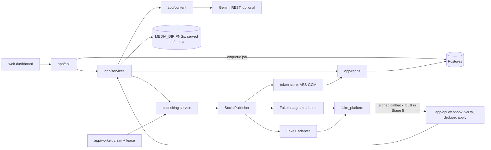

# System Map

How the codebase connects. Each box links to a module note; unresolved links are modules not built yet.
Agents: update this when a module is added, removed or rewired.

## Modules
| Module | Note | Stage |
|---|---|---|
| HTTP layer | [[Api Layer]] | 0+ |
| Fake platform server | [[Fake Platform]] | 1 |
| Data model + migrations | [[Data Model]] | 2 |
| Image pipeline | [[Image Pipeline]] | 2 |
| Caption composer + LLM wrapper | [[Caption Composer]] | 2, 7 |
| Publish flow + retry policy | [[Publishing Service]] | 3 |
| Publisher interface + adapters | [[Publisher Adapters]] | 3 |
| Token crypto | [[Token Crypto]] | 3 |
| Worker + scheduler | [[Worker]] | 4 |
| Webhook + status machine | [[Webhook]] (built) | 5 |
| Dashboard | [[Web]] | 6 |
| Evals | [[Evals]] | 7 |

API contract: [[API]]
